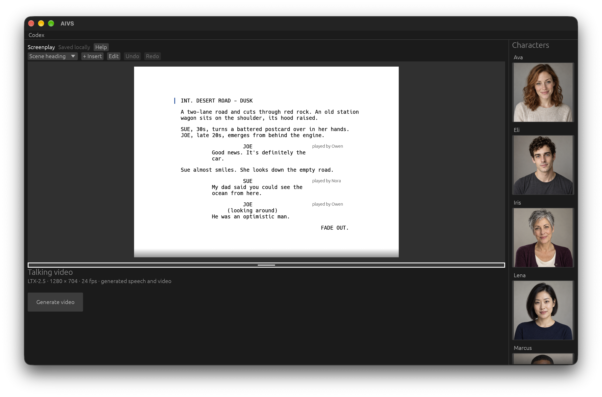

# AIVS

https://github.com/user-attachments/assets/4e372e6e-2cd9-4b2f-ac84-19e1252cea96



AIVS turns a human-readable screenplay into an AI-generated video with speech.
Write a scene, cast its characters, select its heading, and choose **Generate
video**. Codex designs the shots, its built-in image generator creates their starting
compositions, and Codex directs motion from those actual images. **LTX-2.5 HQ
renders each shot's video and audio locally** on an Apple Silicon Mac.

```text
Screenplay + cast
       ↓
Codex pass 1 → shot design + storyboard prompts
       ↓
Codex image generation → visual references + one composed first frame per shot
       ↓
Codex pass 2 → motion, acting, camera and sound from the actual images
       ↓
LTX-2.5 HQ → automatic visual review + media checks
       ↓
FFmpeg assembly → video.mp4
```

The desktop application and production orchestration run in Rust. Rust controls
planning, storyboards, repairs, shot execution, Resume, and validated publication,
launching isolated Python workers for MLX inference. Python also supplies the
model tokenizer, pinned library setup, and the existing artifact fingerprint codec.
Codex planning and automatic visual review use your configured Codex service and
login. Planning sends saved cast portraits and storyboard images to Codex;
visual review sends sampled rendered frames. Storyboard image generation also uses
your Codex login and sends the relevant saved portraits and physical references.
Video inference and media checks run locally; generated dialogue is trusted without transcription.

## The core workflow, with a real example

These historical files come from run `2026-10-26_04-12-06-092171_1035559519`,
before automatic storyboards and the two-pass planner.
Copies live in the repository so you can read them without a local render:
[screenplay.txt](docs/examples/desert-road/screenplay.txt) →
[shooting-script.txt](docs/examples/desert-road/shooting-script.txt).

### 1. Start with a screenplay

The input describes the story in terms a writer understands: a setting, actions,
characters, and dialogue. Here is the original text:

```text
INT. DESERT ROAD - DUSK

A two-lane road and cuts through red rock. An old station wagon sits on the shoulder, its hood raised.

SUE, 30s, turns a battered postcard over in her hands. JOE, late 20s, emerges from behind the engine.

JOE: "Good news. It's definitely the car."

Sue almost smiles. She looks down the empty road.

SUE: "My dad said you could see the ocean from here."

JOE (looking around): "He was an optimistic man."

FADE OUT.
```

### 2. Codex turns the story into directions the video model can use

The app sends the screenplay, cast descriptions, ordered story beats, and
[director instructions](python/shooting-script-instructions.txt) to Codex.
A **beat** is one source action or dialogue line. Codex maps those beats to timed
generation segments and specifies where people stand, what they do, how the
camera sees them, and what should be heard. A segment can contain an explicit
cut while its audio continues. A long action beat can span consecutive segments;
each source dialogue line still appears exactly once in the plan.

In this example, it produces **two shots totaling 21 seconds**:

| Shot | Duration | Source beats | Planned action |
| --- | --- | --- | --- |
| 1 | 10 seconds | 1–4 | Establish the wagon and postcard; Joe steps into view and delivers his first line; Sue almost smiles and looks down the road. |
| 2 | 11 seconds | 5–6 | Sue delivers her line about the ocean; Joe looks around and replies; the scene ends on a quiet reaction. |

An excerpt from the actual first shot shows the added physical detail:

> SUE stands on the gravel screen left beside the front passenger door, holding a battered postcard in both hands. JOE stands on the ground screen right alongside the engine bay, empty hands clear of the engine, upper body partly screened by the raised hood. His feet and route along the near fender remain visible.

The plan also directs sound and the end of the action:

> Finish on this quiet reaction with environmental sound only: dry wind, faint cooling-engine ticks, and gravel crunch synchronized with JOE's step.

The [full shooting script](docs/examples/desert-road/shooting-script.txt) includes
exact dialogue, appearance and voice descriptions, and start/end continuity notes
for each shot. This translation is the core of AIVS: turning a short human scene
into explicit, timed instructions for a video model.

This saved example illustrates screenplay translation, not the current shot
design or a guarantee of visual quality. Current plans give every shot its own
composed storyboard image instead of inheriting the previous shot's final frame.

### 3. Validate, render, and assemble

Preproduction has two Codex passes, with local image generation between them:

1. Design independent shots, canonical physical entities, and source-backed
   opening/ending state contracts. Physical identity, costume, ownership and
   audience visibility are separate facts.
2. Inspect the actual image sequence and its physical references, compare
   neighboring frames and source transitions, then write motion directions.
   Longer sequences use overlapping batches with saved observations.

Codex's built-in image generator creates reusable empty environment plates,
important prop references and full-body references for known morphology, then one still per
shot. Only characters visible at time zero supply actor references; video inference
receives that composed frame rather than the separate portraits. New plans put
entrances at shot boundaries so every person seen in a shot is already visually
anchored in its first frame. Earlier source setup stays in preceding coverage;
an entrance frame shows the arriving person before they approach or sit. Ensemble
staging keeps separate bodies, clear paths and unoccupied destination seats. Earlier
character-filled shots are never used as setting references. Generation uses
Codex app-server and your existing login, without a separate image API key or
local image-model download. Canonical props use centered, evenly lit
product photographs, using the planner's visual description to preserve a concrete
resting layout and connected assembly. Before any prop reference can condition a
storyboard, Codex inspects the actual pixels for exact component counts, extra
parts, coherent assembly and clear connections. For failed or ambiguous references,
the inspector writes a complete replacement description in at most 120 words, specifying correct
placement, support and connections. Retries use that description as their required
prompt, up to three images per reference. Detailed defect reports stay in the
inspection checkpoint. Inspection receipts bind the definition, reviewer and image
bytes; Resume reuses accepted receipts and preserves failed attempts. These
inspections share the planning budget.
Visible opening facts (costume, exposed body traits, components and ownership)
enter the actual image prompt; concealed traits stay private. The complete opening
state and composition reach Codex without the former FLUX 512-token limit.
Identical simple props share a design image, with their separate identities and
states retained in the prompt. The image tool's actual reference paths and hashes
must match the requested inputs. Original generated pixels, prompts and app-server
events are saved before the image is fitted without distortion to LTX's dimensions.
Completed image-tool checkpoints survive interruption and can be reused on Resume.
Codex image generation has no controllable random seed; the saved seed identifies
the request and retry, rather than guaranteeing identical new pixels. Changed references
or prompt inputs regenerate dependent frames, preserving superseded images and
their provenance. The Codex image turn finishes before LTX loads. Rust validates
source coverage, exact dialogue and timing; Python supplies model token limits.
The final shooting script and storyboard checksums are bound
together with an accepted `storyboard-review.json`. The renderer and Resume
reject missing, failed, incompatible or stale acceptance, even when image files
exist. A concrete defect uses the existing two automatic repair rounds, including
state-contract corrections, reference dependencies and reinspection of pixels.
Visible canonical props and connections need positive physical evidence;
unknown details block acceptance. Manually supplied experiment storyboards use
their existing image/provenance checks; declaring the production storyboard
policy still requires continuity acceptance even with automatic review disabled.
Exhausted repairs save `storyboard-diagnostic.json` and stop before video.
The former five-pass planner remains removed.

Both Codex passes share a **10-minute planning budget** by default. Change
**File → Settings… → Planning budget** to allow 1–60 minutes, or use
`--planning-budget-seconds` from the CLI. The budget measures Codex planning time,
including validation corrections; local image and video generation are outside
it. Usage is cumulative across Resume. If the allowance is exhausted, increase
Planning budget in Settings or use `--planning-budget-seconds` when resuming;
completed work remains available.
If a process is forcibly killed before it can record elapsed time, its remaining
allowance stays charged conservatively; increase the budget to continue.

Project runs pin creative revisions in `preproduction/revisions/`. Video seed and
quality selection are independent of the revision, so a preview and a final
render share their plan and images. Editing a scene derives a new revision from
its latest completed revision. Codex receives the source delta and existing
direction and returns changed world definitions and shots, rather than rewriting
the complete shooting script. Unchanged reference images, storyboard pixels,
image inspections, and motion directions are reused when their dependencies match.
The merged revision still passes complete source coverage, timing, continuity,
and independent source-fidelity checks. A broad change can require broader review.
Use `--fresh-preproduction` for new direction and storyboards; reusable physical
design references remain available. Standalone CLI runs retain the existing
`.cache/preproduction/` workflow. Reuse does not establish image or acting quality.

The final directions are saved as `shooting-script.json` and
`shooting-script.txt`. Stable performer identity remains separate from costume,
body state, expression, and emotional delivery. Rendering still needs visual
review: a valid plan does not guarantee that the model executes every action.

LTX-2.5 generates video and speech together in **4–12 second shots at 24 fps**.
Choose **File → Settings…** for **1280×720 (16:9)** or **1080×1920 (9:16)** delivery.
The model requires dimensions divisible by 64, so it generates at 1280×768 or
1088×1920 respectively. Final assembly crops 24 pixels from the top and bottom,
or 4 pixels from each side; it does not stretch the picture. Every new production
shot starts from its own generated image, including reverse angles in the same
scene. Canonical portraits guide still generation; the video model starts in the
scripted location and costume. Portrait planning uses the narrow frame from the
outset, leaving room for essential actions. The model receives each shot's full
motion prompt; separate start/end notes support continuity review.

**Final (HQ)** is the default Quality setting beside **Generate video**. It uses
the full transformer for 15 stage-one steps, then the distilled transformer for
3 stage-two steps. **Final (Standard)** restores the original renderer from before
HQ was added: the distilled pipeline with 8 stage-one steps and 3 stage-two steps,
at the selected full delivery resolution with the same final-quality encoding
as HQ. It provides a faster final render; actual time savings depend on the shot
and hardware. **Preview (180p · fastest)** generates at 320×192 (landscape)
or 192×320 (portrait), then crops to 320×180 or 180×320 delivery. It uses 8+1
steps and faster encoding with the same storyboards, shot timing, 24 fps, and audio
workflow. Low-resolution generation previews composition and timing; it can differ
from the final takes. All three options use local video inference.

New plans use the `single-render-v1` policy to spend planning effort before expensive
video inference. Each missing shot receives one generation, with no automatic rerender
loop. Codex reviews sampled frames for causal continuity, completed actions,
reveals, and tone, recording observed state separately from the intended state.
Storyboard plans remain fixed during rendering. Review findings
or an unavailable visual reviewer do not block assembly or trigger another render;
quality findings remain separate from technical success.

FFmpeg assembles the shots and applies the final fade when requested. The result
must pass decoded-frame and audio/video timing checks before publication as
`video.mp4`. There is no production Whisper dependency, transcription, dialogue
comparison, or pronunciation gate. A mispronounced word cannot stop the scene.
The planner still preserves source dialogue in its prompts.

## Run your first scene

### Prerequisites

- An **Apple Silicon Mac with Metal support** and **Rust 1.92+**.
- **Homebrew**, so setup can install `uv`, FFmpeg, and Git if missing.
- A **Hugging Face access token** for downloading models.
- A current **Codex CLI** with built-in image generation, signed in and available
  on `PATH` (or set `AIVS_CODEX_PATH`). Codex provides screenplay planning,
  storyboard images and automatic visual review; the chat panel is optional.
- Disk space for both model caches and output footage. HQ video setup checks for
  **70 GiB free** on a fresh install, or **22 GiB** when the distilled cache is
  already complete. Required distilled and HQ video model downloads are about
  **62 GB**. Storyboard generation uses your Codex image-generation allowance.

From this checkout:

1. Create `.env` if it does not already exist, using [.env.example](.env.example)
   as a template. Set `HF_API` to your Hugging Face token.
2. Start the app:

   ```sh
   cargo run
   ```

3. Let setup prepare Python 3.12 in `.venv` for video, plus Python 3.10
   in `.cache/seed-vc-env` for saved voices.
   It installs their separate pinned packages, downloads the required
   distilled, HQ, and voice models, and verifies the GPU. Downloads
   reuse the cache. Use **Check again** after adding a token, or **Retry setup**
   after fixing a setup error.
4. If needed, choose **Codex → Sign in with ChatGPT** and finish in your browser.
   An existing Codex login is reused.
5. Edit the screenplay and cast each role in the scene. Drag a gallery character
   onto a role, or use its **Uncast / played by** control. For the sample, try **Ava as Sue**
   and **Eli as Joe**. Casting keeps the script's role names and dialogue intact.
6. Choose **File → Settings…** to select landscape or portrait and adjust the
   planning budget if needed. Landscape and 10 minutes are the defaults.
   These settings save to `settings.json` in the current project.
7. Select a scene by its heading above **Generate video**, then choose
   **Generate video**. Choose **Preview (180p · fastest)** under Quality for faster
   video inference; **Final (HQ)** is the default. Only the selected scene and
   its cast are sent for generation. **Activity** shows planning, storyboard,
   and rendering progress.
   When complete, play the result in the app or choose **Show files**.

**Stop** interrupts the render and its child processes; closing AIVS also stops
active work. Partial outputs remain available for inspection.

If generation or Resume fails, AIVS sounds the system alert, bounces its Dock
icon, adds a red **!** badge, and posts a notification with the error summary.
Failure detection continues while the window is minimized or hidden. Returning
to AIVS or starting another generation clears the Dock alert; the full error
remains in the app. Stop and recoverable take retries do not trigger alerts.
Notifications use macOS AppleScript so they also work with `cargo run`; allow
Script Editor notifications in System Settings → Notifications if banners do
not appear. Focus settings and system sound volume still apply.

Choose **File → Resume…** and select a directory under the project's `runs/`
to continue that run in place. Existing `outputs/<timestamp>_<seed>/` directories
can also be selected. Resume uses its saved screenplay, cast,
seed, render format, inference profile, and shooting script. It reuses completed
planning passes and storyboard images before continuing missing work. New
storyboard plans do not rewrite upcoming shots after video generation begins.
Saved legacy runs retain their footage and historical artifacts; Resume does not
silently switch their inference or image-conditioning policy.
Checkpoints are saved atomically and existing Codex logs are preserved. An
interrupted, incomplete Codex turn is restarted, while completed stages are reused.
Current format and Quality selections do not change a resumed run, including
older 1280×704 runs. Resume uses the higher of its saved planning allowance and
the current Planning budget setting; it retains time already consumed. Existing
shots and compatible archived takes are checked for playable media and matching
provenance, then reused without video inference. Cached visual reviews are reused
when they match the take. A saved take previously rejected only for speech
(such as “chemo” transcribed as “chimo”) is reusable; its historical transcript
does not affect acceptance. Missing shots are rendered only after checking saved
candidates. Invalid saved footage remains an error when no usable saved
alternative is available; Resume does not silently spend a rerender.
Storyboard-conditioned shots are reused only when their recorded frame and plan
still match. Legacy continuation shots also require the same preceding take.

By default, the current directory is the shared runtime workspace. To keep model
caches, Python environments, and credentials elsewhere, pass an existing directory:

```sh
cargo run -- /path/to/workspace
# To select a specific Codex executable:
AIVS_CODEX_PATH=/absolute/path/to/codex cargo run
```

Put `.env` in the selected workspace. Keep this checkout's `python/` and
`experiments/character-consistency/` directories alongside the source when
building; they contain the runtime pipeline and saved-voice setup.

### Projects

AIVS opens an **Untitled** project. If the runtime workspace has an existing
`screenplay.json`, the initial untitled project imports a copy; the original stays
intact. **File → New Project** starts with a blank screenplay.

To start with an existing project open, pass `--project` with its directory or
`project.json` path. You can also supply a runtime workspace directory:

```sh
cargo run -- --project ~/Documents/Untitled.avis
cargo run -- /path/to/workspace --project ~/Documents/Untitled.avis
```

**File → Save** (⌘/Ctrl+S) first asks for a project name and location, defaulting to
the operating system's Documents directory. A project is an ordinary directory,
named `My Film.aivs` by default:

```text
My Film.aivs/
  project.json       Project format and layout
  screenplay.json    Screenplay, casting, and scene assignments
  settings.json      Render format, quality, and planning allowance
  references/        Reusable generated references and their provenance
  preproduction/
    revisions/       Source snapshots, plans, storyboards, and planning task logs
    objects/         Immutable JSON objects shared by revision manifests
    heads/           Latest completed revision for each scene
    cache/           Shared reference sheets and maintenance receipts
  runs/              Render settings, revision bindings, footage, and footage reviews
```

**File → Open Project…** (⌘/Ctrl+O) accepts the directory or its `project.json`.
**Save As…** (⌘/Ctrl+Shift+S) copies the project data to a new directory and
switches to that copy. It preserves the original project. Project assets and
preproduction indexes use relative paths, so the directory can be moved together.
Character and set libraries are global: projects use the shared runtime
workspace's `characters/` and `sets/` libraries, falling back to the checkout's
libraries when absent. Save As skips library copies left in older projects.
Model environments, model downloads, and credentials also stay in the shared
runtime workspace and are not copied into projects.

Untitled projects use temporary storage until saved. New, Open, Close, and Quit
ask whether to save unsaved work. Save or stop a current generation before moving
an untitled project; project switching and Save As wait for active jobs to finish.
Generated references live at project level and can be reused when their design,
input images, and backend match, independently of a new run's seed. Runs read
portraits, voices, and assigned set images directly from the global libraries;
they do not copy characters or sets into the project. Each run records library
roots and asset hashes in its metadata, and resuming detects changed assets.
Older runs with local snapshots continue to use those snapshots.

A run is one render attempt against a fixed creative revision. Small screenplay
edits create another revision and run; changing quality alone creates another run
of the same revision. Resume continues the selected attempt and never substitutes
the current editor contents. Source blocks and shots retain stable IDs across
edits, saves, and reordering. A run's `preproduction.json` records its revision
using a project-relative path. Completed revisions are not edited in place.

On the next project generation, compatible legacy preproduction is imported into
shared revision storage. The old run files remain available for historical
footage receipts. New revisions reference reused storyboard images directly;
unchanged JSON objects are stored once by content hash. JSON manifests use
`$aivs_object` references; the Rust artifact reader and Python compatibility
helpers resolve these and check object hashes. Run requests layer quality and
planning allowance over a shared source object using `$aivs_base`/`$aivs_fields`.
Planning logs belong to the revision that performed the work. Rendered video,
sampled frames, and footage reviews belong to their run. Video inference still
executes per run; creative reuse does not splice preview footage into HQ output.

Image generation retains one original `.image` master and the normalized
storyboard used by the renderer. Image bytes are never embedded in protocol logs;
logs record the master path, SHA-256 and byte count. Successful Codex sessions
keep compact summaries with timing, token usage and diagnostics. Requests,
responses, approval records and interrupted/failed session details remain saved.
Set `AIVS_KEEP_STREAM_LOGS=1` when launching AIVS to retain successful streaming
events too; image payloads still stay outside logs.

Reference sheets are shared under `preproduction/cache/reference-sheets/`, keyed
by source image hashes and source numbering. Completed legacy revisions are
compacted before the next render after AIVS acquires the workspace render lock.
Cleanup preserves approved plans, final storyboards and one original image,
removes verified duplicate originals, and moves legacy sheets into the shared
cache. Small sheet receipts allow exact old paths and bytes to be restored if an
image-generation checkpoint needs recovery. Already-compacted revisions are
skipped. Standalone output layouts remain readable.

After any active render finishes, maintenance can also be requested explicitly:

```sh
cargo run -- --production compact --project-dir "/path/to/My Film.aivs"
```

Add `--revision REVISION_ID` to compact only one completed revision. Maintenance
uses the same workspace lock as rendering and refuses to run while a render is
active. It does not run Codex, load models, or regenerate any images or video.

### Editing and casting

Scripts and cast assignments belong to the project's `screenplay.json`.
**⌘/Ctrl+S** saves changes; untitled edits are also staged in temporary storage.
Click text to edit; use the element selector,
**+ Insert**, and **Edit** for formatting, insertion, deletion, and role renaming.

Use **File → Import…** to choose a `.fountain` screenplay. Import replaces the
current screenplay and clears its cast; **Undo** restores both. Scene headings,
action, character cues, parentheticals, dialogue, and transitions become editable
elements. Centered text and lyrics retain their text in action/dialogue elements;
simultaneous dialogue is imported in source order. Title-page metadata, outline
sections, notes, omitted passages, page breaks, and emphasis formatting are omitted.
The original Fountain file is preserved. Save the project to persist the imported
screenplay. Full-length scripts can be imported; video generation uses
one selected scene at a time, within a 100,000-character limit per scene.

Fountain is a plain-text screenplay format; [nyousefi/Fountain](https://github.com/nyousefi/Fountain)
provides a reference implementation and sample scripts. Try the [Big Fish
sample](https://github.com/nyousefi/Fountain/blob/master/FountainTests/Big%20Fish.fountain):
[download the raw `.fountain` file](https://raw.githubusercontent.com/nyousefi/Fountain/master/FountainTests/Big%20Fish.fountain),
then choose **File → Import…** in AIVS. Select a scene heading from the **Scene**
menu, cast its characters, then choose **Generate video**. AIVS plans and renders
only that scene; the rest of the imported screenplay remains available to edit
and render scene by scene.

- **Enter** creates the next screenplay element; **Shift+Enter** inserts a line break.
- **Tab** in dialogue adds a parenthetical instruction. On an empty action, it
  changes the element to a character cue; **Shift+Tab** selects the previous type.
- **Backspace** on an empty element steps backward through its formats, then
  removes it. One blank scene heading remains when the script is cleared.
- **⌘/Ctrl+Z** and **⌘/Ctrl+Shift+Z** undo and redo edits, including casting.

New GUI screenplay renders use the gallery's actual saved assets. Saved
portraits guide Codex's generation of each shot's first frame, including shots
with multiple visible performers. Codex receives the portraits when designing
shots, then the generated images when writing motion directions. A shot with
one speaking performer has its native soundtrack converted with Seed-VC toward
that performer's saved voice sample. The video stream is copied unchanged.
This preserves native picture timing; it does not prove voice identity or lip sync.

Generated compositions do not guarantee cast identity. Shots with multiple
speakers retain generated voices because there
are no isolated dialogue tracks. These limitations appear in the activity log and
each shot's `character_assets` record. Silent shots do not run voice conversion.

### Storyboard image generation

Storyboards and canonical physical references use the same signed-in Codex CLI
as planning. The app-server request invokes the built-in image-generation skill
and accepts an actual completed image-tool result, rather than a textual claim.
The existing prop and sequence inspections still gate video rendering. Update
Codex if its image tool is unavailable, then sign in and Resume.

Desktop startup checks local storyboard tooling without generating images or
requiring ChatGPT sign-in. The full capability check runs when generating or
resuming storyboards, with progress visible in Activity.

Preflight generates a small cup image and performs a reference-guided color
edit through the same app-server transport used for storyboards. It requires an
actual completed image-generation event and exact reference path/SHA-256
metadata; installing the CLI alone is insufficient. A successful check is cached
for 24 hours under `.cache/imagegen-preflight/`, bound to the CLI version and
account/configuration fingerprints. The first check uses two image generations.
Run `python/storyboard_backend.py check --refresh` to repeat it after a capability
change. Unsupported reference metadata fails during preflight with the installed
version and diagnostic path; AIVS does not guess a minimum supported version.

For a CLI workspace whose video environment already exists:

```sh
.venv/bin/python python/storyboard_backend.py check
.venv/bin/python experiments/character-consistency/setup_voice_conversion.py
.venv/bin/python python/setup_sync.py
.venv/bin/python python/video.py download --profile hq
```

Director coverage has its own cache under `.cache/preproduction/directors/`.
Changing only the image backend reuses that coverage; image generation,
inspection and image-informed motion direction have separate identities.
Completed scene plans and images are reused through `.cache/preproduction/`.
Generation saves image prompts, request seeds, reference hashes, original image
bytes and backend provenance alongside each run. An interrupted local-FLUX run
regenerates its physical references and affected frames with Codex, preserving
superseded assets. No FLUX environment or image weights are required.
Shot-specific references are prioritized and limited to five actual image-tool
inputs. Overflow is consolidated into labeled reference sheets with source
hashes; essential references are never silently dropped. Requests too large for
readable sheets fail explicitly. Normalization preserves the full source image
and pads aspect-ratio differences instead of cropping hands or props. Saved
provenance includes the source size and normalized content rectangle; visual
review inspects those normalized pixels before rendering.

Local FLUX remains an optional, explicitly selected backend. Install it separately
from the video environment:

```sh
uv venv .venv-storyboard --python 3.12
uv pip install --python .venv-storyboard/bin/python -r python/requirements-storyboard.txt
.venv/bin/python python/storyboard_mflux.py download
export AIVS_STORYBOARD_BACKEND=mflux
.venv/bin/python python/storyboard_backend.py check
```

The default is `AIVS_STORYBOARD_BACKEND=codex-imagegen`. AIVS never switches
backends silently. FLUX uses the previously pinned MFLUX version and local
weights, including its 512-token prompt limit; oversized essential briefs fail
instead of being truncated. An app launched from Finder needs this environment
variable supplied by its launch environment.

Before downloading model weights, setup checks missing video files against their
pinned download sizes. Complete cached files are
reused; damaged and partial files count as missing. The check reserves another
2 GiB for temporary files and 5 GiB for generated outputs, accounting for separate
cache and output volumes.

### Saved character rendering setup

Desktop setup installs and verifies the pinned Seed-VC converter automatically,
in a separate environment from MLX. Restart AIVS after updating an existing
installation to complete this setup, then use **File → Resume…** for a failed run.
Setup reuses verified model files and preserves local changes in the converter's
source checkout.

Desktop setup also prepares speech timing, face detection and audiovisual sync
models in `.cache/sync-review/`, with a separate CPU environment. For an existing
CLI workspace, run `.venv/bin/python python/setup_sync.py`. Runtime review is
offline; downloads happen only during setup. Asset URLs, revisions and checksums
are recorded in [sync-assets.json](python/sync-assets.json). The reviewer uses
[SyncNet](https://github.com/joonson/syncnet_python),
[YuNet](https://github.com/opencv/opencv_zoo/tree/main/models/face_detection_yunet),
and [faster-whisper](https://github.com/SYSTRAN/faster-whisper); setup retains
upstream license notices beside the models.

For CLI setup, run this from the checkout (add
`--workspace /path/to/workspace` for a different workspace):

```sh
.venv/bin/python experiments/character-consistency/setup_voice_conversion.py
```

CLI setup requires `uv` and `git` on `PATH`. Before Codex planning,
screenplay rendering checks every cast portrait and each speaking character's
saved voice sample, then checks the converter's code revision, model hashes and
MPS availability. A missing or invalid converter stops the run with a setup
error. Install it, then use Resume.

For a smoke test without Seed-VC, select `--voice-mode native` on a new CLI
screenplay render. This explicitly retains the model's generated voices and
does not require saved voice samples. The GUI keeps saved voices as its default.
Voice mode is saved with the run and cannot change on Resume; changing it needs
a new run. Native and saved-voice plans use distinct cache identities.

Each shot keeps `video.source.mp4`, the original native picture and soundtrack,
plus `voice/source.wav`, `voice/converted.wav`, and conversion provenance.
The final `video.mp4` uses the converted soundtrack. Audio duration drift greater
than 100 ms stops conversion; smaller differences are padded or trimmed without
retiming the picture. Final soundtrack correlation is checked against the converted
PCM. Conversion acts on the whole mono soundtrack and can change ambience, so
start with clean dialogue in quiet scenes. Converter or asset changes invalidate
take reuse. Interrupted conversion reuses its matching native video on Resume.
Older runs retain their original rendering behavior; older plans must be regenerated
for the new saved-asset policy.

For the first comparison, use [this two-scene request](docs/examples/saved-character-two-scenes.json):
one role cast as Ava, alone in an office and a train compartment. Paste its script
into the GUI and cast TRAVELER as Ava, or run the same GUI backend directly:

```sh
.venv/bin/python python/video.py render \
  --screenplay-file docs/examples/saved-character-two-scenes.json --seed 83
```

Compare both scenes against Ava's portrait and voice sample, including face identity,
voice identity, spoken words, and lip sync. This example has not been rendered or
accepted as a quality milestone.

## Where to start in the code

Follow the main path: **UI → preproduction → storyboard images → motion plan → shot renderer**.

| File | Responsibility |
| --- | --- |
| [src/app.rs](src/app.rs) | Desktop workspace, setup gate, and optional chat UI. |
| [src/screenplay.rs](src/screenplay.rs) | Screenplay editor, casting, and document persistence. |
| [src/video.rs](src/video.rs) | Starts setup/render workers, handles cancellation, and reads Rust production progress events. |
| [crates/aivs-core](crates/aivs-core) | Headless Rust screenplay compilation, continuity, approval rules, media validation, FFmpeg assembly, and shared Codex sessions. |
| [python/rust_engine.py](python/rust_engine.py) | Versioned JSON transport to the Rust engine and current-source cache fingerprints. |
| [crates/aivs-core/src/production](crates/aivs-core/src/production) | Production CLI, planning passes, storyboard generation and repairs, shot execution, visual review, and Resume. |
| [python/video.py](python/video.py) | Compatibility launcher for the Rust production CLI. |
| [python/preproduction.py](python/preproduction.py) | Compatibility calls into Rust preproduction. |
| [python/shooting_script.py](python/shooting_script.py) | Compatibility calls into Rust screenplay planning. |
| [crates/aivs-core/src/shooting_script](crates/aivs-core/src/shooting_script) | Screenplay parsing, cast binding, source coverage, exact dialogue expansion, timing floors, planning schemas, and fidelity/approval validation. |
| [crates/aivs-core/src/media.rs](crates/aivs-core/src/media.rs) | FFmpeg frame extraction, shot assembly, FFprobe checks and full media decoding, with child cleanup on cancellation. |
| [crates/aivs-core/src/continuity](crates/aivs-core/src/continuity) | Continuity schemas, state rules, sequence review, snapshot comparisons, and acceptance bindings. |
| [crates/aivs-core/src/render_formats.rs](crates/aivs-core/src/render_formats.rs) | Delivery dimensions, aligned model canvases, and framing guidance. |
| [crates/aivs-core/src/characters.rs](crates/aivs-core/src/characters.rs) | Performer lookup, quote-aware references, and shared profile/asset validation. |
| [crates/aivs-core/src/dialogue.rs](crates/aivs-core/src/dialogue.rs) | Dialogue and screenplay action duration estimates. |
| [python/shooting-script-instructions.txt](python/shooting-script-instructions.txt) | Director guidance for staging, timing, continuity, and sound. Start here to improve planning. |
| [python/storyboard.py](python/storyboard.py) | Compatibility calls into Rust storyboard production. |
| [crates/aivs-core/src/storyboard_backend.rs](crates/aivs-core/src/storyboard_backend.rs) | Codex ImageGen preflight, generation/edit sessions, input verification and checkpoint recovery. |
| [crates/aivs-core/src/storyboard_images.rs](crates/aivs-core/src/storyboard_images.rs) | Reference sheets, EXIF orientation, Lanczos fitting and opaque PNG output. |
| [python/storyboard_backend.py](python/storyboard_backend.py) | Compatibility adapter to Rust ImageGen and optional Python MFLUX inference. |
| [python/quality_backend.py](python/quality_backend.py) | Local LTX-2.5/MLX generation and model setup. |
| [crates/aivs-core/src/inference.rs](crates/aivs-core/src/inference.rs) | Versioned Python worker requests, progress, cancellation and process cleanup. |
| [python/inference_worker.py](python/inference_worker.py) | Runs one LTX or MFLUX model request and exits. |
| [src/codex.rs](src/codex.rs) | Codex account login and optional chat integration using the shared Rust transport. |
| [src/main.rs](src/main.rs), [src/playback.rs](src/playback.rs) | Native egui/winit/wgpu window and macOS AVKit playback. |

### How the Codex integration works

AIVS launches `codex app-server` and exchanges newline-delimited JSON over
stdin/stdout using the [official Codex app-server protocol](https://learn.chatgpt.com/docs/app-server).
For each preproduction pass, the Rust production planner requests an isolated
Codex session. Rust initializes a connection, creates an
ephemeral read-only thread, and starts a turn with the
source, pass-specific instructions and JSON output schema. It streams activity
into the UI and validates each result. The first pass designs compositions; the
second receives the actual storyboard images and returns motion directions
bound to them. Both consume the same saved planning allowance.

Image generation and visual inspection use the same Rust production-session
implementation, including local-image attachments, streamed activity, raw logs,
partial final responses, and deadlines. Image generation uses its own writable
workspace. Rust owns ImageGen checkpoints, preflight, reference preparation,
input verification and output normalization; the Python adapter forwards activity
and routes optional local MFLUX inference. The
protocol follows the [official app-server documentation](https://learn.chatgpt.com/docs/app-server).

The client in `src/codex.rs` handles login and optional chat in a separate session,
sharing the Rust wire protocol with production work.
**Show chat** opens that panel; chat threads use `workspace-write` in the current
project directory, with network access disabled and `approvalPolicy: never`. Reconnecting
starts a fresh chat. The Codex CLI owns credentials, and AIVS inherits its model
and reasoning defaults.

Change story direction in the director instructions. Continuity rules belong in
`aivs-core` and must remain independent of particular story props.

### Rust production engine

`aivs-core` runs without the desktop. Its `production` module controls both Codex
planning passes, persisted budgets, shared caches, reference inspection, bounded
storyboard and fidelity repairs, motion keyframes, shot scheduling, voice
conversion, visual review, take recovery, and final assembly. The desktop invokes
the same production CLI in a child process.

For a standalone headless build:

```bash
cargo build -p aivs-core --bin aivs-engine
target/debug/aivs-engine --production --help
```

`python/video.py` remains a compatibility launcher for the same CLI. Other small
Python adapters call the versioned JSON engine protocol. They find a built
`aivs-engine` or `aivs` under `target/debug` or `target/release`, respecting
`CARGO_TARGET_DIR`; `AIVS_ENGINE_PATH` selects an executable explicitly. The bridge
never builds automatically and rejects an engine whose compiled sources differ
from the checkout. Rebuild after changing Rust code.

The engine accepts newline-delimited versioned JSON on stdin and emits results
and progress events on stdout. For example:

```json
{"version":1,"id":1,"operation":"facts","args":{"state":{"characters":[],"props":[],"reveals":[],"relationships":[]}}}
```

The response is `{"version":1,"id":1,"result":[]}`. Domain errors return an
`error` and `error_kind`; long operations emit `event` envelopes with the same
request ID. Each Codex request uses its own app-server process and ephemeral
thread. Cancellation or a deadline ends the session and reaps its child.

Rust owns source coverage, exact dialogue expansion, timing, physical continuity,
hand-object constraints, canonical prop inspection, acceptance receipts, and
screenplay/cast snapshots. Image generation verifies reference hashes and preserves
completed checkpoints and superseded images. Repairs preserve failed evidence and
stop before video if their allowance is exhausted.

Rust also owns FFmpeg execution, contact sheets, decoded media checks, and validated
publication. Resume checks saved take provenance, image and video hashes, voice
assets, renderer configuration, motion keyframes, and predecessor clips before
reusing footage. Native picture survives interrupted voice conversion. Visual
quality reports remain advisory and never authorize another video inference.

Python remains for LTX/MLX and optional MFLUX inference, model-specific runtime
hooks, tokenization, pinned-library setup, and the legacy JSON fingerprint codec.
Rust launches disposable model subprocesses and waits for their successful exit
before returning results, releasing model resources between stages. The separate
Seed-VC worker remains in `experiments/character-consistency` because production
still uses it; its completed experiment-only mode has been removed.

Existing fingerprint serialization rules remain unchanged. Cache and review
identities include Python source, the bridge, and compiled Rust sources; source
changes still invalidate implementation-bound identities. Historical outputs,
reference images, acceptance records, and model caches are preserved.

The completed A/B/C cloud comparison, native-reference diagnostics, Kokoro
milestone renders, and one-off review/comparison tools have been retired. They are
not being maintained as a second filmmaking pipeline.

## Inspect and debug a run

Desktop runs write to `<project>/runs/<timestamp>_<seed>/`. CLI runs use
`outputs/<timestamp>_<seed>/` in the runtime workspace unless
`--project-dir "/path/to/My Film.aivs"` selects an existing project. Resume discovers the project
from its run directory. For project runs, follow `preproduction.json` to find the
creative files below in their shared revision directory. Rendered media and its
reviews remain in the run. Legacy and standalone runs retain the local layout.

| Artifact | What to inspect |
| --- | --- |
| `screenplay.txt`, `screenplay-request.json` | Original script and cast bindings. |
| `storyboard-plan.json`, `storyboard-plan.txt` | First-pass shot design and still-image prompts. |
| `storyboards.json`, `storyboards/` | Verified first-frame images, prompts, reference hashes, and generation provenance. |
| `storyboard-references.json` | Bindings to canonical environment, prop/component and body images in the project's `references/`; legacy runs keep `storyboards/references/`. |
| `storyboard-review.json` | Expected/observed opening states, source evidence, physical/sequence violations, uncertainty, and exact acceptance binding. |
| `storyboard-repairs.json`, `storyboard-review-before-repair-*.json`, `storyboard-diagnostic.json` | Bounded repair journal, preserved findings, and terminal rejection diagnostics. |
| `shooting-script.txt`, `shooting-script.json` | Readable directions and the validated machine plan. |
| `planning-budget.json` | Cumulative Codex planning time, allowance, and last pass. |
| `preproduction.json` | Run-to-revision binding; legacy runs record cache identity and reuse provenance. |
| `revision.json`, `input.json`, `delta.json` | Completed revision identity and parent, immutable inputs, and the bounded director patch (when derived from an earlier revision). |
| `shooting-script-request-*`, `shooting-script-response-*` | What the planner sent to Codex and received back. |
| `shooting-script-events-*.jsonl`, `shooting-script-errors-*.txt` | Live protocol events and diagnostics, including failed or stopped planning. |
| Historical `shooting-script-draft-*`, `shooting-script-review*`, `shooting-script-progress.json` | Preserved artifacts from the removed five-pass planner. |
| `shots/001/`, `shots/002/`, … | Individual takes and their reports, including automatic `visual_review` findings for new plans. |
| `shots/<shot>/visual-review/review.json` | Timestamped visual evidence, observed state, and quality findings. |
| `shots/<shot>/sync-review/review.json` | Per-speaker, per-turn timing measurements against the delivered video and audio, with confidence and unassessed intervals. |
| Legacy `shots/<shot>/adaptation/` | Revisions of upcoming directions for older continuation-based plans. |
| `scene-review/review.json` | Synthesis of sampled shot observations against the source's continuity, story, and tone; not full-speed playback. |
| `takes/<shot>/<take>/` | Archived takes, seeds, and diagnostics from replacements. |
| Historical `speech-*` files | Retained from older runs; production rendering and Resume do not use them. |
| `render.json` | Seed, status, prompts, timing, runtime details, and errors. |
| `video.mp4` | Final validated assembly, present after a successful render. |

For planning work, you can skip video inference after completing setup. From the
checkout using its default workspace:

```sh
.venv/bin/python python/video.py render \
  --script-file docs/examples/desert-road/screenplay.txt \
  --cast SUE=ava --cast JOE=eli \
  --plan-only
```

Without an existing matching preproduction cache, `--plan-only` runs the director
pass and saves `storyboard-plan.json` and `.txt`. It generates no images and does
not run the image-based motion pass; the draft is not yet renderable. A matching
completed cache can supply the full plan immediately. Add `--fresh-preproduction`
to inspect a newly generated director draft. Remove `--plan-only` for the complete
workflow, or Resume the saved draft's run directory.
Add `--render-format portrait` for 1080×1920; `--script-file` defaults to landscape.
`--profile hq` is the default; use `--profile standard` for the original faster
full-resolution renderer or `--profile distilled` for preview. Repeating
the same scene with a different video profile or seed automatically reuses its
matching completed preproduction.
With `--project-dir`, edited scenes automatically derive from their latest
completed revision. Use `--parent-revision REVISION_ID` to choose another base
explicitly. The ID is recorded in a project's run binding and revision manifest.

Every screenplay render also checks speech sync on the assembled delivery,
after voice conversion and fades. This check is independent of sampled visual
review and runs for all three quality settings. It locates scripted English lines
in the audio, tracks visible faces at the SyncNet model's required 25fps, and
measures local audio lead/lag within each speaking turn. The initial policy
uses a 120ms tolerance, a +/-800ms search, and confidence and active-face
ambiguity gates. Short lines, hidden faces, ambiguous speakers, missing setup,
timeouts and low confidence remain `unassessed`; they cannot count as passes.
Detected sync defects produce `rendered-with-issues`, while inconclusive checks
produce `rendered-needs-review` unless another review already found an issue.
The Runs panel shows the affected speakers and times. No automatic rerender or
soundtrack shift is performed. Prompt-only renders lack a speaker contract and
remain unassessed. These automated checks do not certify voice identity or
replace watching the result.

For project renders, a sync-passing performance whose scripted words were all
matched can be reused as fixed audio on later runs. One immutable PCM object
lives in `preproduction/cache/dialogue/audio/`; small contract receipts reference
it. The contract includes the shot's words, cues, actions, casting, voice assets,
duration and direction, and excludes quality and seed. Changing the contract
regenerates the affected shot's performance. Both the distilled and HQ paths
condition video on this fixed audio through both generation stages, then mux
the original PCM performance and validate waveform preservation. A fixed track
is not voice-converted again. Its new footage receives a fresh sync check.
New dialogue without a reusable performance still uses native joint generation
and the same acceptance check. `--fresh-dialogue` on a new screenplay render
requests a new performance while retaining reusable preproduction. Resume
always keeps the audio choice recorded in the original take. Old runs are not
modified or imported into the dialogue cache automatically.

To inspect actual generated first frames and motion directions before video
inference, use `--storyboards-only`. This completes both planning passes, image
generation, bounded image repairs, and the source-fidelity check, then saves
`storyboards.json`, its images, and `shooting-script.json`. It does not require
LTX weights or Seed-VC, but needs the cached LTX tokenizer, Codex image generation,
and cast portraits. Saved voice samples and the converter are
checked when you later Resume into video rendering. `--plan-only` and
`--storyboards-only` are mutually exclusive.

For a small first run, [this single-line scene](docs/examples/storyboard-smoke.json)
uses Ava's saved portrait and explicit native voices:

```sh
.venv/bin/python python/video.py render \
  --screenplay-file docs/examples/storyboard-smoke.json \
  --storyboards-only --seed 83
```

Inspect the stills in the emitted output directory. Continue that same plan into
HQ video with `python/video.py resume --output-dir /path/to/output-directory`.
Add `--storyboards-only` to Resume to finish or inspect only the image stage.
This debug stop is optional; ordinary production continues automatically.

`--shooting-script /path/to/shooting-script.json` imports a finalized storyboard
plan and the bound images from the same directory, revalidating them against the
current script, cast, and format. Keep the storyboard plan, manifest, acceptance
report, reference library and image files beside that plan. Older storyboard
approvals without the current continuity contract are incompatible; preserve
their artifacts and start a fresh run. Changing format requires new preproduction.

To resume an existing run from the command line:

```sh
.venv/bin/python python/video.py resume --output-dir /path/to/output-directory
```

To increase an exhausted planning allowance to 15 minutes total while retaining
completed work:

```sh
.venv/bin/python python/video.py resume \
  --output-dir /path/to/output-directory --planning-budget-seconds 900
```

## Verify changes

```sh
cargo test
cargo clippy --all-targets -- -D warnings
cargo fmt --check
```

The Rust suites cover editing, casting, setup, cancellation, Codex protocol
handling, and responsive UI layout. Python unit tests have been removed as
production logic moves into Rust. Use the storyboard and Resume commands above
to check production behavior. Optional integration checks:

```sh
# Reuse an existing model cache while testing setup in a temporary workspace.
AIVS_TEST_CACHE=/absolute/path/to/.cache/huggingface \
  cargo test live_setup_installs_python_then_skips_installation_on_the_next_launch -- --ignored
# Use an existing ChatGPT login for a small live Codex request.
cargo test live_app_server_streams_a_complete_reply -- --ignored
```

## Current limits

Timing is estimated, and generated actions, faces, voices, and lip sync can still
fail. Automatic visual review samples frames rather than observing every instant;
it can miss defects or misjudge a performance. Its report describes quality, not a
guarantee. Portrait-conditioned storyboard images establish each shot's composition,
but do not lock identity across new angles or locations. Native-timing voice conversion
also requires audiovisual review. The pipeline completes without per-shot human approval and avoids
automatic rerenders; a technically complete scene can contain reported visual
issues. Generated dialogue is not independently checked.

The editor has no print pagination or Final Draft import/export. Other renderers
and separate speech synthesis are outside the main workflow. The [character consistency archive](experiments/character-consistency/README.md)
preserves the results of the earlier fixed-audio and Seed-VC investigations.
Their one-off reproduction scripts have been retired.

`.env`, `.venv`, `.venv-storyboard`, `.cache`, `screenplay.json`, `settings.json`, and generated `outputs/` stay out of Git.
The adapted Studio source retains its **GPL-3.0-only** license; see [LICENSE](LICENSE).
